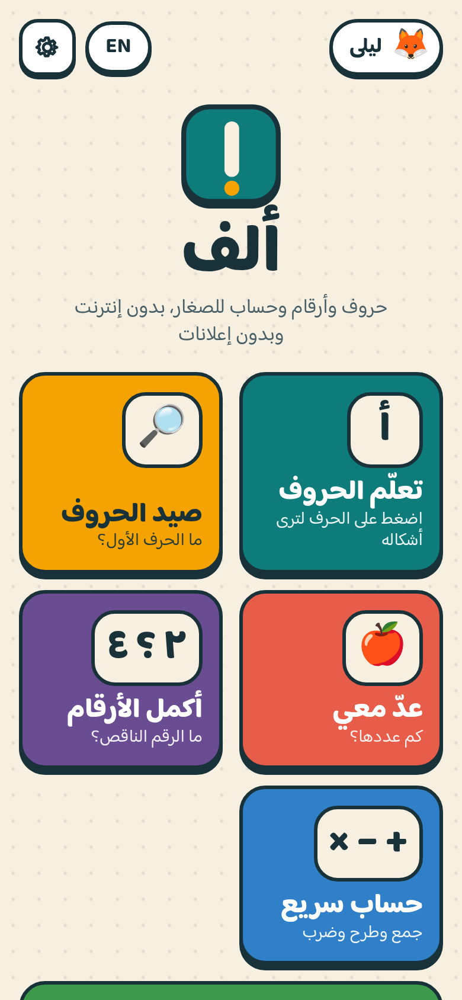
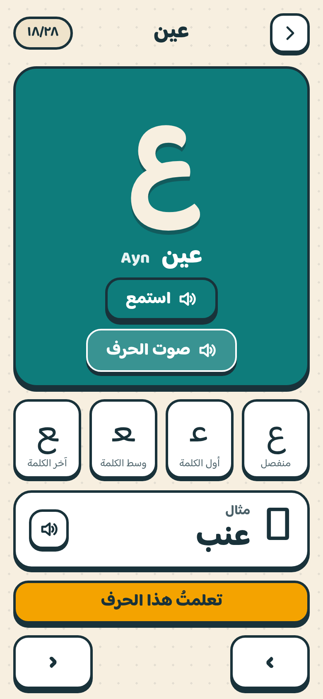
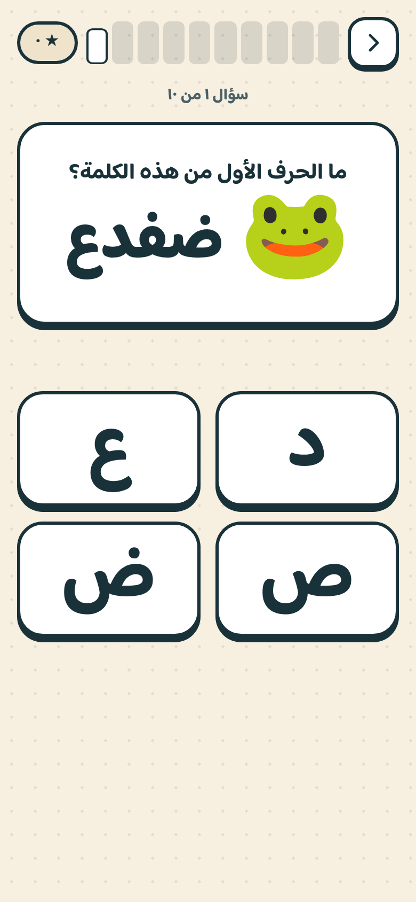
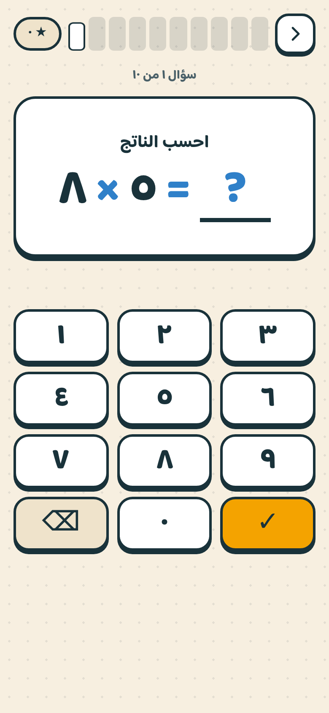
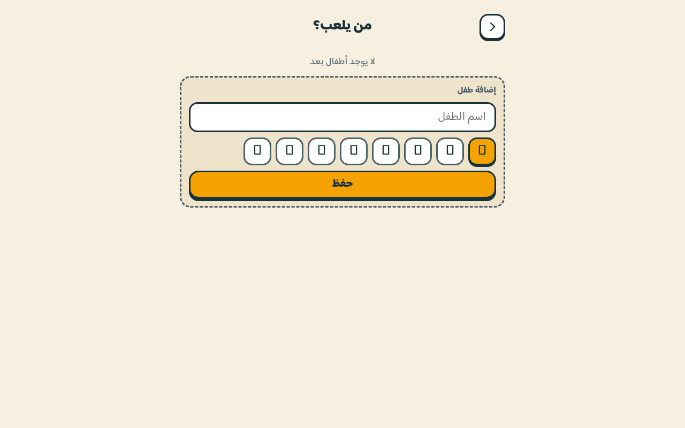
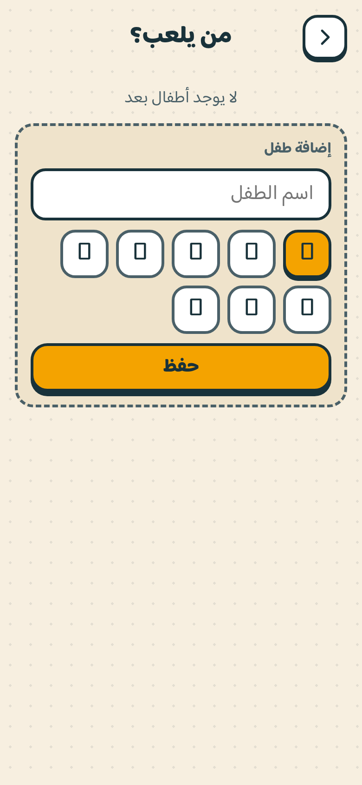
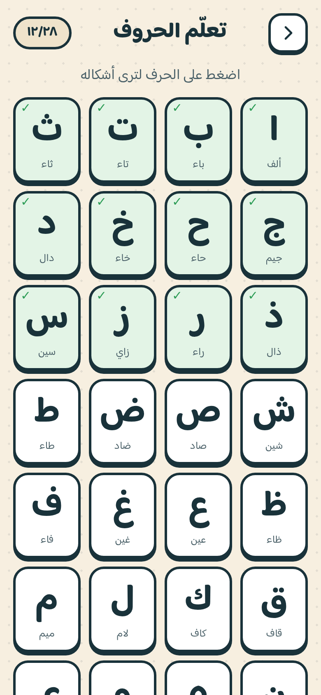
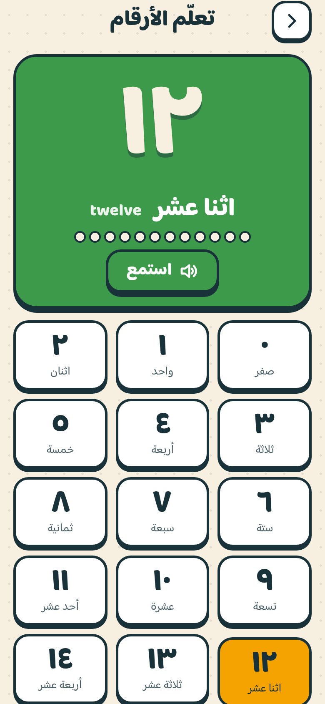
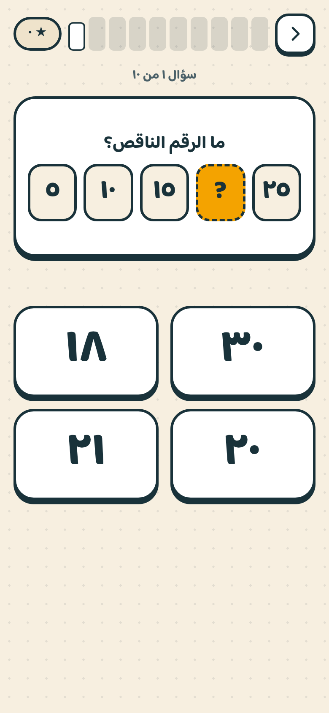
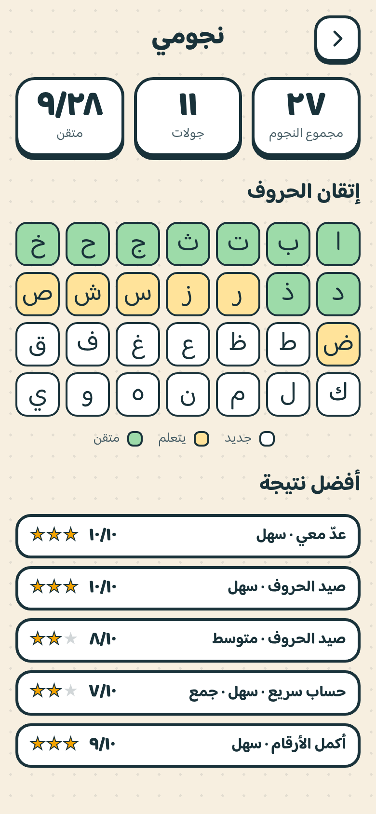

<p align="center"></p>

<h1 align="center">Alif | ألف</h1>

<p align="center"><b>Arabic letters, numbers and sums for kids. Works offline. No ads, no accounts.</b><br>
حروف وأرقام وحساب للصغار، بدون إنترنت وبدون إعلانات</p>

<p align="center"><a href="https://yousefkhames.github.io/alif/"><b>Open the live demo</b></a> · <code>https://yousefkhames.github.io/alif/</code></p>

<p align="center">
  
  
  
  
</p>

## Screenshots

Captured from the live site (https://yousefkhames.github.io/alif/) with sample demo content entered for the screenshot. It is not real user data.

<p>
  
  
</p>

## Why

Most kids' learning apps are full of ads, want an account, or stop working without a connection. Alif is a small set of games a parent can hand over without watching: it loads once, then runs on the device. It has no ads, no tracking, no accounts and no server. A child's progress stays in the browser.

## What is in it

- **Learn letters.** All 28 Arabic letters. Each has its name, its four shapes (alone, start, middle, end of a word), an example word with a picture, and a Listen button. Mark a letter as learned.
- **Learn numbers.** 0 to 20 with the digit, the word in Arabic and English, and a row of dots.
- **Letter hunt.** Ten questions a round. Either see a word and pick its first letter, or see a letter and pick the matching picture. Level 2 and 3 use look-alike letters (ب ت ث ن ي, ج ح خ, ع غ, ف ق ...) as wrong answers. Level 3 hides the picture. The game picks the letters a child knows least more often.
- **Count with me.** Count up to 5, 10 or 20 things and pick the number.
- **Number gaps.** Find the missing number. Counting by 1, then 2, 5 and 10, then backwards.
- **Quick math.** Add, subtract, multiply or mixed. Levels 1 and 2 use four choices. Level 3 uses a keypad (a physical keyboard works too).
- **Stars and progress.** 1 to 3 stars a round, best score per game, a mastery grid for all 28 letters.
- **Up to 6 children** on one device, each with a name, an avatar and their own progress.
- **Grown-ups corner** behind a small multiplication question: language, Arabic-Indic or Western digits, sounds, spoken letters, child management, backup file download and import, and a press-and-hold erase.
- **Arabic and English**, with proper right-to-left layout. Mobile first, big touch targets, keyboard and screen reader labels, reduced-motion support.
- **Offline.** A service worker caches the app after the first visit.

## Screenshots

| Learn letters | Numbers | Number gaps | Progress |
|---|---|---|---|
|  |  |  |  |

The screenshots use sample data (a child called "ليلى"), not a real profile. They are generated by `npm run shots`.

## Tech

Plain HTML, CSS and JavaScript. No framework, no build step, no runtime dependencies. Data is kept in `localStorage`. Game logic (`js/logic.js`) and storage (`js/store.js`) have no DOM code, so they run under Node for tests. The only font is Baloo Bhaijaan 2 (SIL OFL, see `fonts/OFL.txt`), subset and bundled, so nothing is fetched from a CDN.

```
index.html  manifest.webmanifest  sw.js
js/   data.js  logic.js  store.js  app.js
css/  style.css
tests/ unit.test.js  e2e.js
```

## Run it

```
python3 -m http.server 8123      # or any static file server
# open http://localhost:8123/
```

## Tests

```
npm install            # only needed for the browser test (puppeteer-core)
npm test               # unit tests: letter data, question generators, scoring, storage
BASE=http://localhost:8123/ npm run test:e2e   # real Chrome click-through
BASE=http://localhost:8123/ node tests/audio.js # audio clips, playback and offline
```

The browser test plays full rounds of every game, checks wrong-answer behavior, profiles, backup import (including a bad file), press-and-hold erase, persistence across reloads, English and Arabic layout, and that the app loads with the network turned off and makes no request outside its own origin. It needs Chrome at `/usr/bin/google-chrome` (set `CHROME` to change it).

## Honest limits

- GitHub Pages is a demo host. For a real classroom or home, host the files yourself.
- Progress lives in one browser on one device. Clearing site data erases it. Use the backup file in the grown-ups corner to move it. There is no sync.
- Pronunciation uses 110 bundled recordings in `audio/` (about 0.6 MB), played by the app and cached for offline use. They are synthetic speech from a Gemini text-to-speech voice (Erinome, Modern Standard Arabic, fully vowelled text), not a human teacher. Nobody has checked them with a native Arabic speaker, so some clips (for example letter sounds and the emphatic letters) may sound slightly off. A native speaker should review them. The device's own Arabic voice is used only if a clip fails to load.
- Earlier versions used `edge-tts` clips (Microsoft voice, unofficial route); `scripts/gen-audio.py` is the legacy script for those and no longer produces the shipped files. Check the speech provider's terms before commercial use. To replace a clip, record a short mp3 with the same file name.
- The parent gate is a multiplication question. It keeps small children out, it is not security.
- Example words and pictures use emoji, which look different on each platform. Some words are in Modern Standard Arabic, not a local dialect.
- Letter shapes in the "four shapes" view depend on the browser's Arabic text shaping.
- No handwriting practice, no diacritics (tashkeel) and no letters-to-words reading yet.
- Tested in Chrome on a phone-sized viewport. Not tested on every browser or on Safari/iOS.

## License

MIT, see [LICENSE](LICENSE). Baloo Bhaijaan 2 font: SIL Open Font License 1.1.
